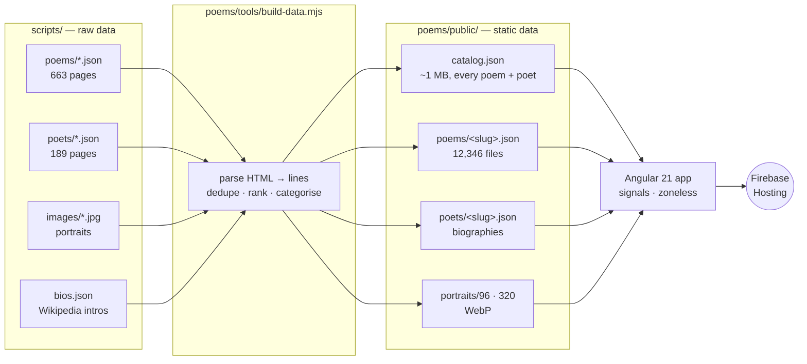

<p align="center">
  <picture>
    <source media="(prefers-color-scheme: dark)" srcset="doc-images/logo-dark.svg">
    
  </picture>
</p>

<h3 align="center">Twelve thousand poems, played like music.</h3>

<p align="center">
  A poetry library dressed as a music player. Press play and a poem's lines light up one by one at a
  reading pace; poems queue, shuffle and repeat like tracks, poets have “artist” pages, and every poem
  gets its own album cover.
</p>

<p align="center">
  <a href="https://poeticmusings.web.app"></a>
  
  
  
  
  
</p>

<p align="center">
  <a href="https://poeticmusings.web.app"><b>Open the site</b></a> ·
  <a href="#a-tour"><b>Tour</b></a> ·
  <a href="#how-it-works"><b>How it works</b></a> ·
  <a href="#development"><b>Develop</b></a>
</p>

<p align="center">
  <picture>
    <source media="(prefers-color-scheme: dark)" srcset="doc-images/home-dark.webp">
    
  </picture>
</p>

---

## The idea

Music apps are wonderful at one thing poetry sites rarely manage: making you want to press play.
Poetic Musings borrows the whole grammar — charts, artists, genres, queues, a player bar with a
spinning record — and points it at **12,346 poems by 3,256 poets**A poem “plays” like a track: each line is timed to a natural reading pace, the current line is
marked and fills in as you go, and the page follows along. Its length shows up as a track duration
(*The Raven* is 8:35, *Nothing Gold Can Stay* is 0:20). When it ends, the next poem in your queue
begins.

<p align="center">
  
  <br><sub><i>Stage mode — the poem as full-screen synced lyrics.</i></sub>
</p>

---

## Features

| | |
| --- | --- |
| **Play a poem** | Lines are timed per word and stanza; the active line is marked and fills in as it’s read, and the view follows. Click any line to jump there. Speed from 0.75× to 2×. |
| **Line waveform** | The progress bar is a waveform where every bar is a line of the poem — long lines tall, stanza breaks silent. Scrub it; hover to preview the line. |
| **Stage mode** | Press <kbd>F</kbd> for a full-screen, lyrics-style view over the poet’s portrait, with a turning record. |
| **Generative album art** | Every poem gets its own sleeve — sun-over-horizon, grooves, Bauhaus arches, halftone, waves, a giant initial — seeded by its slug, so it never changes. |
| **Poets as artists** | Portrait headers, life dates, movements, and a short biography (from Wikipedia, with a drop cap), plus their discography and “readers also love”. |
| **Charts, genres, eras** | Top 100, Classics (pre-1950) and Contemporary, six eras from the Renaissance to now, and 37 movements from Romanticism to Slam. |
| **Queue, shuffle, repeat** | Anything you play becomes the queue; opening a poem directly builds a “radio” from the poet and their neighbours on the charts. |
| **Instant search** | <kbd>Ctrl</kbd>/<kbd>⌘</kbd>+<kbd>K</kbd> from anywhere — titles and poets, ranked by popularity. <kbd>⇧</kbd>+<kbd>↵</kbd> plays straight away. |
| **Your library** | Liked poems and reading history, kept on your device. |
| **Paper & ink** | A warm light theme and a true-black dark theme, WCAG-AA contrast throughout, paper grain, and reduced-motion support. |
| **Built for phones** | A mini player above a tab bar, full-screen stage on tap, and installable to the home screen as an app. |
| **Keyboard first** | Everything has a shortcut — press <kbd>?</kbd> on the site. |

---

## A tour

<p align="center">
  
  <br><sub><i>The reader: line waveform, Up Next, and the current line filling in.</i></sub>
</p>

<p align="center">
  
  <br><sub><i>On a phone — Listen Now, a poem playing, Stage mode and a poet page.</i></sub>
</p>

<table>
  <tr>
    <td width="50%"><br><sub><b>Poets</b> — portrait, biography, discography.</sub></td>
    <td width="50%"><br><sub><b>Genres</b> — the Classics ribbon, in dark mode.</sub></td>
  </tr>
  <tr>
    <td width="50%"><br><sub><b>Stage</b> — synced, full-screen reading.</sub></td>
    <td width="50%"><br><sub><b>Browse</b> — genres, eras and movements.</sub></td>
  </tr>
</table>

---

## How it works

There is no backend. A build step turns a scrape of [poets.org](https://poets.org) into small static
files, and the app is a static Angular site on Firebase Hosting — fast, cheap, and cacheable at the edge.



**The catalog** is loaded once (~250 KB gzipped) and holds every poem’s title, poet, year, line count,
chart position and estimated read time — enough for charts, search, genres and queues without a server.
**A poem’s text** is fetched only when you open it: one small JSON file of `[indent, html]` lines.

**Playing a poem** is a timeline. `PlayerService` turns the lines into start times (word count at
~130 wpm, a pause at stanza breaks) and runs a `requestAnimationFrame` clock through them. Everything else
— the active line, the waveform, the elapsed time, the mini-player’s quoted line, auto-advance — is a
`computed()` signal derived from one `position` value.

<details>
<summary><b>More detail</b></summary>

- **Parsing poems.** The scraped bodies are messy HTML (`<pre>`, `&nbsp;` indentation, `<em>` spanning
  line breaks, stray styles). `parseBody()` normalises them into lines, keeps indentation as a level,
  re-balances inline tags per line and strips everything else.
- **Charts.** The order poets.org returns poems in is treated as popularity — that’s the rank shown in the
  Top 100, the pool for Poem of the Day, and the tie-breaker in search.
- **Classics vs Contemporary.** Published before 1950 → Classic (falling back to the poet’s death year).
- **Biographies.** `tools/fetch-bios.mjs` asks Wikipedia for each poet and only keeps a match if it
  describes a writer *and* mentions the poet’s birth year, retrying as “Name (poet)” — so namesakes and
  disambiguation pages are dropped rather than shown as the wrong person.
- **Covers.** `app-cover` is a seeded SVG composition (eight styles × twelve print palettes) with a
  paper-grain overlay, so 12k poems get distinct, stable artwork at zero download cost.
- **Scrolling.** Only the content pane scrolls, so the player bar is a fixed part of the layout on every
  screen size; scroll position is restored on back/forward.

</details>

---

## Keyboard

| Key | Action | Key | Action |
| --- | --- | --- | --- |
| <kbd>Space</kbd> | Play / pause | <kbd>F</kbd> | Stage mode |
| <kbd>N</kbd> / <kbd>P</kbd> | Next / previous poem | <kbd>Q</kbd> | Queue |
| <kbd>→</kbd> / <kbd>←</kbd> | Next / previous line | <kbd>L</kbd> | Like |
| <kbd>S</kbd> | Shuffle | <kbd>T</kbd> | Light / dark |
| <kbd>R</kbd> | Repeat (off → all → one) | <kbd>/</kbd> or <kbd>Ctrl</kbd>+<kbd>K</kbd> | Search |

---

## Repository structure

```text
poetic-musings/
├── poems/                      # The web app (Angular 21, standalone + signals, zoneless)
│   ├── src/app/
│   │   ├── core/               # Catalog, player (timeline/queue), library, theme, formatting
│   │   ├── layout/             # Sidebar, player bar, stage, queue, Ctrl+K palette, mobile nav
│   │   ├── pages/              # Home, poem, poet, genre, collection, browse, poets, library, search
│   │   └── ui/                 # Cover art, portrait, waveform, track list, cards, icons
│   ├── src/styles/             # Design tokens (light/dark), base, shared components
│   ├── tools/
│   │   ├── build-data.mjs      # scripts/ → public/data + public/portraits
│   │   ├── fetch-bios.mjs      # Wikipedia biographies → scripts/bios.json
│   │   └── make-icons.mjs      # Home-screen / PWA icons from the logo
│   ├── public/                 # Logo, manifest, icons (+ generated data & portraits)
│   └── firebase.json           # Hosting config: SPA rewrite + cache headers
│
├── scripts/                    # Raw data and the original Python scrapers
│   ├── poems/ · poets/         # poets.org API pages
│   ├── images/                 # Poet portraits
│   ├── bios.json               # Verified Wikipedia intros
│   └── fetch_*.py              # Scrapers
│
├── ui ux/                      # Original mock-ups and the logo source
└── doc-images/                 # README imagery
```

---

## Development

Requires **Node.js 20.19+** (Angular 21).

```bash
npm run setup        # install the app's dependencies
npm start            # http://localhost:4202 — builds the data on first run
```

From `poems/` the usual Angular commands work too (`npm start`, `npm run build`, `npm test`).

### Data

The generated data (`poems/public/data`, `poems/public/portraits`) isn’t committed — it’s built from
`scripts/` automatically before `start`/`build`, or explicitly:

```bash
npm run data         # rebuild catalog, poem files, biographies and portraits (~1 min)
npm run bios         # refresh biographies from Wikipedia (resumable, rate-limit aware)
```

To refresh the scrape itself, run the Python scripts in `scripts/` (`fetch_poems.py`, `fetch_poets.py`,
`fetch_poet_images.py`), then `npm run data`.

### Deploy

The site deploys to Firebase Hosting (project **`poeticmusings`**```bash
npm run deploy       # production build + firebase deploy --only hosting
```

Live at **https://poeticmusings.web.app**JS/CSS are cached immutably, portraits for 30 days and data
for an hour (stale-while-revalidate), so returning visitors load almost nothing.

---

## Design notes

- **Type.** [Fraunces](https://fonts.google.com/specimen/Fraunces) for display, [EB Garamond](https://fonts.google.com/specimen/EB+Garamond)
  for the poems themselves, [Inter](https://fonts.google.com/specimen/Inter) for the interface.
- **Colour.** Paper (`#f4f1ea`) and ink (`#161513`), a true-black stage for the player, and one warm accent
  for hearts. The muted text tones are tuned to WCAG AA in both themes.
- **Reading first.** Poem text never changes weight or colour while playing — progress is shown *behind*
  the line, never by fading the words.
- **Motion.** Spinning records, a breathing cover while a poem plays, view transitions between pages —
  all switched off under `prefers-reduced-motion`.

---

## Roadmap

- **Natural readings** — real recorded readings (public-domain LibriVox recordings for the classics) and
  carefully directed narration for the rest, aligned to the lines at build time.
- **Sync your library** — likes and history in Firestore so they follow you between devices.
- **Offline** — a service worker so recently read poems open with no connection.

---

## Credits

- **Poems and poet data** from [poets.org](https://poets.org) (Academy of American Poets). Poems remain
  the copyright of their authors and publishers; this project is a non-commercial reading experience.
- **Biographies** from [Wikipedia](https://en.wikipedia.org), available under
  [CC BY-SA 4.0](https://creativecommons.org/licenses/by-sa/4.0/) and credited on each poet page.
- **Icons** are hand-tuned [Lucide](https://lucide.dev)-style shapes (ISC).

<p align="center"><sub>Made with ink, paper and a turntable by <a href="https://github.com/breejesh">@breejesh</a>.</sub></p>
