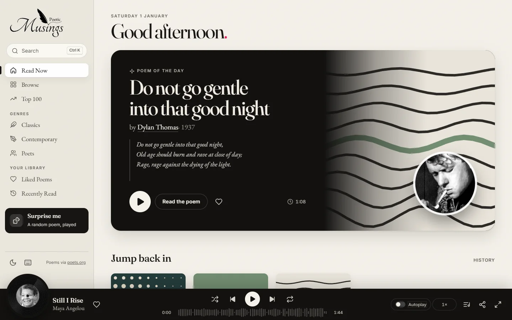
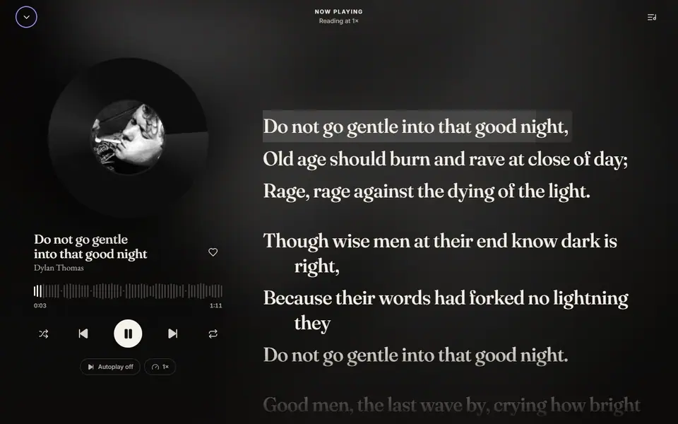
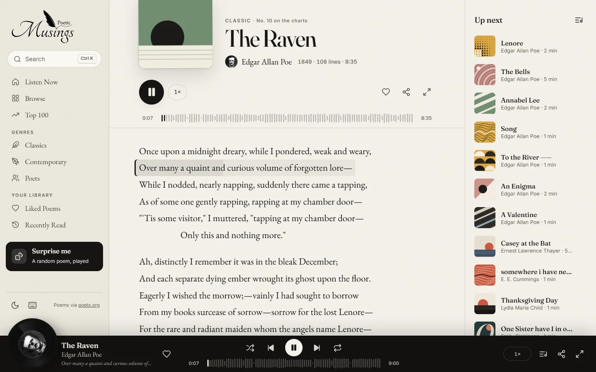
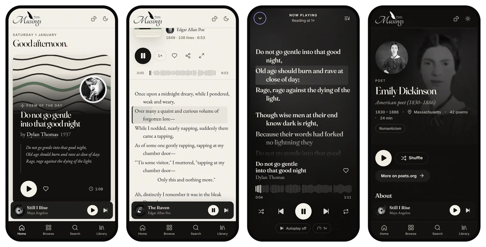
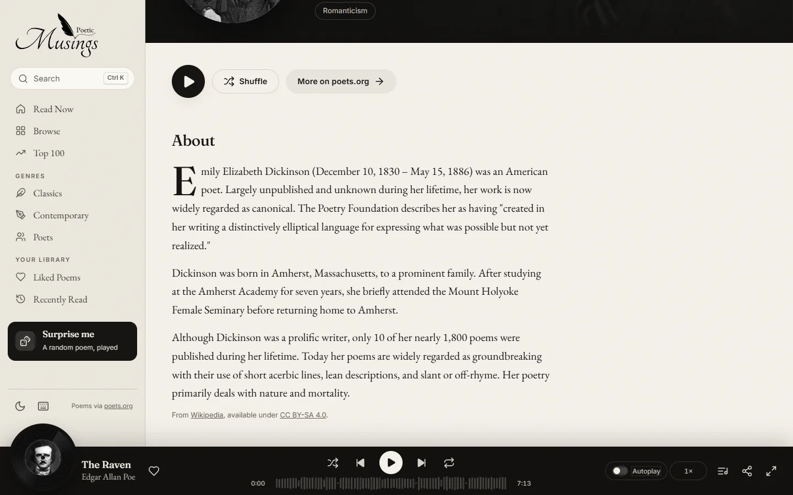
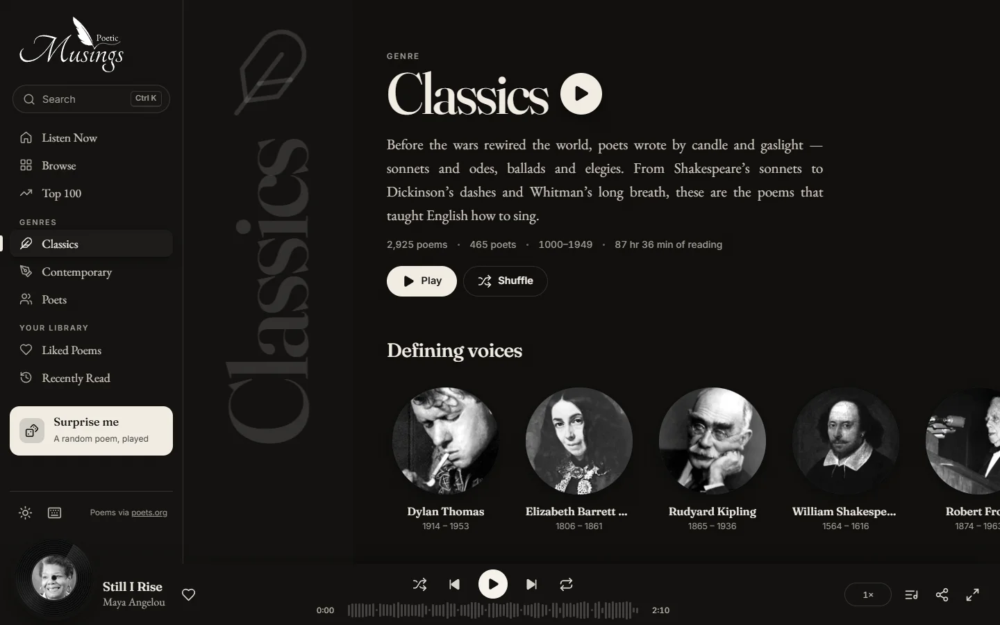
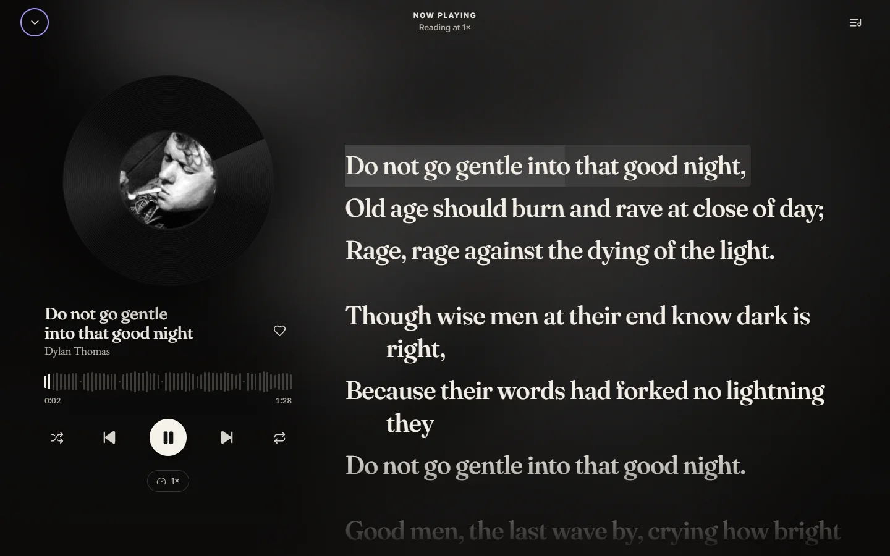
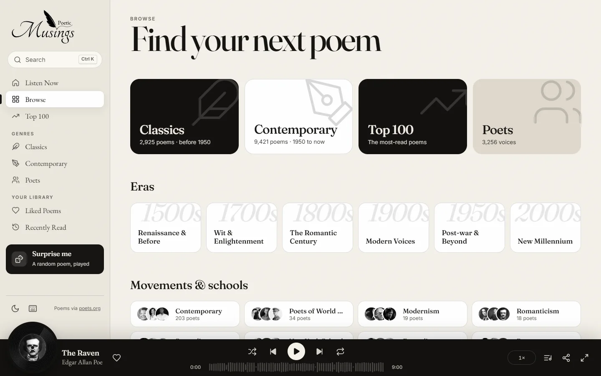

  <picture>
    <source media="(prefers-color-scheme: dark)" srcset="doc-images/logo-dark.svg">
    
  </picture>

<h3 align="center">World's most beautiful poetry website.</h3>

  A poetry library dressed as a music player. Press play and a poem's lines light up one by one at a
  reading pace; poems queue, shuffle and repeat like tracks, poets have “artist” pages, and every poem
  gets its own album cover. 12000 poems.

  
  
  
  
  
  

  <a href="https://poeticmusings.web.app"><b>Open the site</b></a> ·
  <a href="#a-tour"><b>Tour</b></a> ·
  <a href="#how-it-works"><b>How it works</b></a> ·
  <a href="#development"><b>Develop</b></a>

  <picture>
    <source media="(prefers-color-scheme: dark)" srcset="doc-images/home-dark.webp">
    
  </picture>

---

## The idea

Music apps are wonderful at one thing poetry sites rarely manage: making you want to press play.
Poetic Musings borrows the whole grammar — charts, artists, genres, queues, a player bar with a
spinning record — and points it at **12,346 poems by 3,256 poets**A poem “plays” like a track: each line is timed to a natural reading pace, the current line is
marked and fills in as you go, and the page follows along. Its length shows up as a track duration
(*The Raven* is 6:53, *Nothing Gold Can Stay* is 0:16). When it ends it stops, with the next poem in
your queue one tap away — or switch on **Autoplay** to keep going.

  
   <i>Stage mode — the poem as full-screen synced lyrics.</i>

---

## Features

| | |
| --- | --- |
| **Play a poem** | Lines are timed per word and stanza; the active line is marked and fills in as it’s read, and the view follows. Click any line to jump there. Speed from 0.75× to 2×. |
| **Line waveform** | The progress bar is a waveform where every bar is a line of the poem — long lines tall, stanza breaks silent. Scrub it; hover to preview the line. |
| **Stage mode** | Press <kbd>F</kbd> for a full-screen, lyrics-style view over the poet’s portrait, with a turning record. |
| **Generative album art** | Every poem gets its own sleeve — sun-over-horizon, grooves, Bauhaus arches, halftone, waves, a giant initial — seeded by its slug, so it never changes. |
| **Poets as artists** | Portrait headers, life dates, movements, and a short biography (from Wikipedia, with a drop cap), plus their discography and “readers also love”. |
| **Charts, genres, eras** | Top 100, Classics (pre-1950) and Contemporary, six eras from the Renaissance to now, and 37 movements from Romanticism to Slam. |
| **Queue, shuffle, autoplay** | Anything you play becomes the queue; opening a poem directly builds a “radio” from the poet and their neighbours on the charts. Poems stop when they end unless Autoplay is on; Repeat replays the current poem. |
| **Instant search** | <kbd>Ctrl</kbd>/<kbd>⌘</kbd>+<kbd>K</kbd> from anywhere — titles and poets, ranked by popularity. <kbd>⇧</kbd>+<kbd>↵</kbd> plays straight away. |
| **Your library** | Liked poems and reading history, kept on your device. |
| **Paper & ink** | A warm light theme and a true-black dark theme, WCAG-AA contrast throughout, paper grain, and reduced-motion support. |
| **Built for phones** | A mini player above a tab bar, full-screen stage on tap, and installable to the home screen as an app. |
| **Keyboard first** | Everything has a shortcut — press <kbd>?</kbd> on the site. |

---

## A tour

  
   <i>The reader: line waveform, Up Next, and the current line filling in.</i>

  
   <i>On a phone — Read Now, a poem playing, Stage mode and a poet page.</i>

<table>
  <tr>
    <td width="50%"> <b>Poets</b> — portrait, biography, discography.</td>
    <td width="50%"> <b>Genres</b> — the Classics ribbon, in dark mode.</td>
  </tr>
  <tr>
    <td width="50%"> <b>Stage</b> — synced, full-screen reading.</td>
    <td width="50%"> <b>Browse</b> — genres, eras and movements.</td>
  </tr>
</table>

---

## Keyboard

| Key | Action | Key | Action |
| --- | --- | --- | --- |
| <kbd>Space</kbd> | Play / pause | <kbd>F</kbd> | Stage mode |
| <kbd>N</kbd> / <kbd>P</kbd> | Next / previous poem | <kbd>Q</kbd> | Queue |
| <kbd>→</kbd> / <kbd>←</kbd> | Next / previous line | <kbd>L</kbd> | Like |
| <kbd>S</kbd> | Shuffle | <kbd>T</kbd> | Light / dark |
| <kbd>R</kbd> | Repeat this poem | <kbd>/</kbd> or <kbd>Ctrl</kbd>+<kbd>K</kbd> | Search |
| <kbd>A</kbd> | Autoplay next poem | <kbd>?</kbd> | All shortcuts |

---

## Design notes

- **Type.** [Fraunces](https://fonts.google.com/specimen/Fraunces) for display, [EB Garamond](https://fonts.google.com/specimen/EB+Garamond)
  for the poems themselves, [Inter](https://fonts.google.com/specimen/Inter) for the interface.
- **Colour.** Paper (`#f4f1ea`) and ink (`#161513`), a true-black stage for the player, and one warm accent
  for hearts. The muted text tones are tuned to WCAG AA in both themes.
- **Reading first.** Poem text never changes weight or colour while playing — progress is shown *behind*
  the line, never by fading the words.
- **Motion.** Spinning records, a breathing cover while a poem plays, view transitions between pages —
  all switched off under `prefers-reduced-motion`.

---

## Roadmap

- **Natural readings** — real recorded readings (public-domain LibriVox recordings for the classics) and
  carefully directed narration for the rest, aligned to the lines at build time.
- **Sync your library** — likes and history in Firestore so they follow you between devices.
- **Offline** — a service worker so recently read poems open with no connection.

---

## Credits

- **Poems and poet data** from [poets.org](https://poets.org) (Academy of American Poets). Poems remain
  the copyright of their authors and publishers; this project is a non-commercial reading experience.
- **Biographies** from [Wikipedia](https://en.wikipedia.org), available under
  [CC BY-SA 4.0](https://creativecommons.org/licenses/by-sa/4.0/) and credited on each poet page.
- **Icons** are hand-tuned [Lucide](https://lucide.dev)-style shapes (ISC).

Made with ink, paper and a turntable by <a href="https://github.com/breejesh">@breejesh</a>.

